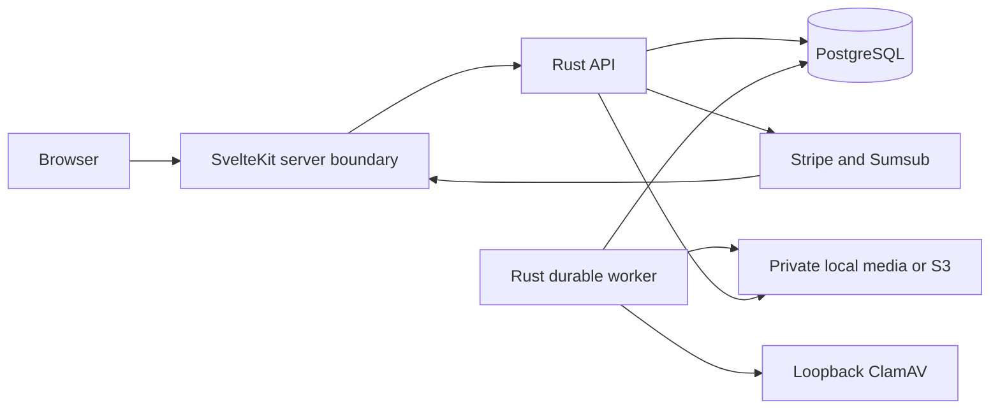

# Architecture

Status: implemented sandbox and production deployment configuration; target-account acceptance requires operator information. Date: October 7, 2026.

## Boundaries

SvelteKit renders the UI and provides a browser-facing server boundary. Rust owns authorization and business state. PostgreSQL stores accounts, token digests, profiles, media records, posts, entitlements, financial records, jobs, messages, notifications, reports, and audit history.

The modular monolith keeps financial writes and access grants in one database transaction. Independent microservices are unnecessary before workload measurements justify separate ownership or scaling boundaries. A durable job table provides leases, retries, and failed-job review; multiple worker processes can claim jobs with SKIP LOCKED.

## Identity and sessions

Argon2 hashes use generated salts. Password work is limited to four concurrent operations. Auth attempts have both account-based and global database limits. Opaque session tokens remain in HttpOnly host-only cookies; only SHA-256 digests are stored in PostgreSQL. The BFF forwards tokens internally and never exposes them through page data. Request origins and route/method allowlists are checked before browser mutations are proxied.

TOTP secrets are encrypted using AES-256-GCM under a separately backed-up private key. The matched TOTP step is stored to prevent replay. MFA verification and enrollment are committed in one transaction; recovery requests lock their common account before recovery tokens and consume all outstanding reset links atomically. New MFA key files are atomically published and synchronized with their containing directory on Unix. MFA enrollment elevates only the session that supplied the code; older sessions cannot inherit administrative access. Administrator actions and payout requests require recent session-level MFA assurance. Password changes/reset and suspensions revoke sessions.

MFA enrollment generates ten one-time recovery codes; only SHA-256 digests persist. Code use and rotation follow the account lock order and commit with session revocation. Recovery keeps MFA enabled but marks the account as requiring replacement; server authorization rejects privileged assurance until a newly enrolled authenticator is verified. Rotation requires the password and current TOTP, invalidates previous codes, and revokes other sessions. The printable codes appear only in the response to enrollment or rotation and are excluded from exports.

The default sandbox mail spool supports local verification/recovery testing and cannot prove mailbox ownership. Optional authenticated SMTP uses mandatory TLS and certificate validation, an encrypted transactional outbox, bounded delivery leases and retries, and stable Message-IDs across attempts. SMTP mode hides every local inbox link; old sandbox messages remain ineligible for external delivery. Encryption authenticates both the message ID and recipient, and successful/terminal deliveries erase the encrypted body. Verification resends serialize on the account, invalidate earlier links, and have account/global rate limits. SMTP acceptance does not prove inbox delivery; a lost acknowledgment can cause duplicate delivery. SES signed-channel feedback correlates account/configuration-set/message/recipient and suppresses hard bounces and complaints. WAF and application rate controls bound public abuse. Actual mailbox/provider/DNS and support/identity acceptance require the configured account.

## Money and access

Amounts use integer minor units and explicit currencies; the sandbox is USD. Prices are read from owned server records. Checkout creation serializes per viewer and compares request fingerprints for idempotency-key reuse. Confirmation locks the checkout, posts balanced ledger entries, grants the matching entitlement, and records notification/outbox/job/audit state atomically.

Ledger transactions and postings are immutable after posting. Deferred database constraints enforce balancing and currency consistency. Checkout and payout identity/amount fields are immutable, with constrained state transitions. Payout requests serialize on the owner and reserve available funds before review; retries cannot double-reserve. Refunds append reversals and revoke the original access. A refund after payout can create recoverable negative creator balances.

The migration owner and runtime role are distinct. Runtime grants exclude schema DDL, TRUNCATE, financial deletion, and audit mutation. Database privileges are tested by completing a purchase as the runtime role and attempting forbidden operations.

Sandbox financial confirmation never implies external payment. Stripe mode instead uses connected-account direct charges, hosted Checkout/onboarding, signed raw-body webhooks, current provider-object verification, immutable receipt identities and paid-period entitlements. Stripe owns bank payouts and balances; its hosted dashboard replaces local sandbox reservations. Refund/dispute observations revoke the relevant entitlement and cannot regress. A durable paginated event reconciler covers missed notifications with independent account leases. Checkout recovery resumes known sessions, discovers lost responses, and holds indeterminate outcomes for investigation. Independent immutable provider transactions reconcile gross/fee/net/tax, refunds, dispute movements and payout membership. Admin workflows resolve uncertain checkouts only from verified provider evidence. Won disputes restore access only after a verified current merchant-win outcome with no refunds or other adverse disputes; adjudication remains the provider/bank responsibility. Provider/tax acceptance uses the real account. See [provider contracts](provider-setup.md).

Sumsub hosted verification requires completed overall review, matching client/level/creator, approved document/selfie steps, and an adult birth date from the approved document. Callbacks only enqueue current-state reads; raw identity evidence is not stored. A per-creator lock serializes reads, periodic refresh detects changed reviews, and revoked identity removes local creator approval. Moderator approval remains separate.

## Publishing and private media

Uploads first enter processing state with generated storage names. Format detection ignores user-supplied MIME declarations. Image decode dimensions/allocation are bounded; processed images are re-encoded. Video probes/transcodes have deadlines, restricted protocols, dimension/duration/output limits, and bounded CPU parallelism. Source uploads are removed after processing; only sanitized renditions enter review.

Owned approved media can be attached to posts. Video requires valid plain WebVTT captions. Publishing checks email state, creator approval, and media approval. Scheduled jobs re-check those conditions. Report removal adds a moderation block that creators cannot override; an administrator must restore the post to drafts with an audited reason.

Feed responses omit full media and caption URLs when access is missing. The media handler independently checks current entitlement, approval, publication, and moderation state before every full/byte-range request. Private responses are not cached. Seed stock assets are public examples; private uploaded media is a separate storage boundary.

Media responses stream with backpressure and bounded byte ranges. S3 uses expected-owner checks, workload credentials, explicit encryption and private cache directives. Durable resumable uploads use fixed 4 MiB chunks, row locks, retry hashes and authoritative offsets. Workers verify assembled integrity, scan before decode and produce MP4 plus HLS renditions. Every playlist, segment and caption rechecks entitlement. CloudFront private origin caching is disabled, preserving immediate authorization on each request. Linux decoders run with no inherited application environment, Landlock filesystem boundaries, seccomp network/process restrictions, no capabilities and CPU/memory/output limits. Worker lease loss cancels processing; private scratch guards clean normal cancellation paths. [AWS runtime](aws-runtime.md) covers signed object/database/key recovery and target-account acceptance.

## Operations and limits

Structured request logs include a generated request ID, method, path without query parameters, status, and elapsed time. Logs omit bodies, credentials, cookies, and arbitrary SQL errors. Pool acquisition, statements, locks, HTTP calls, and request bodies are bounded. Liveness/readiness endpoints and administrator queues expose local operational state.

The feed supports indexed search and 50-row timestamp/UUID cursor pages; category, creator, Saved, and Following filters apply before pagination. Studio, notifications, subscriptions, mail, financial posting history, payouts, conversation history, comments, safety lists, and administrative queues also expose 50-row cursor pages. Filters and authorization apply before page boundaries; multi-collection views use separate cursors, oldest pending reviews come first, and each financial posting has its own identifier. Pages are live views rather than database snapshots: newly updated conversations may move to the newest page. Visible online messaging and notification views poll incrementally with cancellation, identity checks and backoff. Rate limits are shared through PostgreSQL. The selected deployment is one region with Multi-AZ database/compute and durable recovery; it does not claim region-loss failover. Privacy-preserving logs, EMF metrics, dashboards and alarms are supplied. Production capacity and alert delivery require target-account measurement. No enterprise certification or production SLO is claimed from the local test results.

## Release choices

Direct dependencies, Node/pnpm/Rust toolchains, lockfiles, container base digests, and FFmpeg source checksum are pinned. SvelteKit 3 configuration lives in Vite; environment variables are declared explicitly. TypeScript 6 and native dialogs are recorded compatibility decisions. CI executes type/build/unit/database/browser checks with PostgreSQL 18.6 and pinned FFmpeg 9.0.2.
